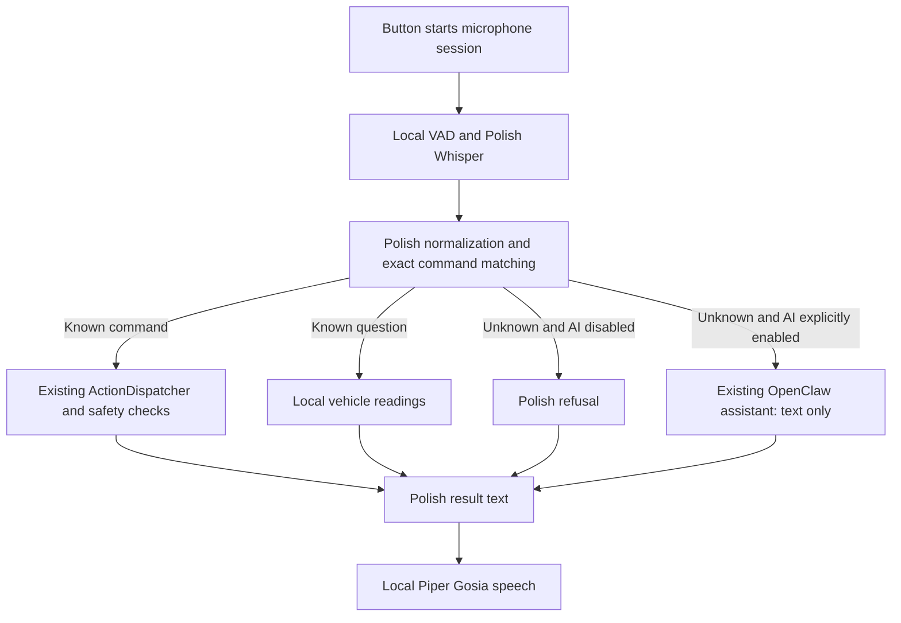

# Polish voice control: offline commands, optional online AI

Status: approved by the user on 2026-10-20 after independent review.

[Short design view](./polish-voice-overview.html)

## Problem

The user wants to speak Polish to BYDMate, use common commands without internet, and optionally use online AI. The current `GigaAmAsrEngine` loads a Russian GigaAM model; `VoiceNormalizer`, `VoiceDictionary`, `NluParser`, and the voice replies also assume Russian. Translating command phrases alone cannot provide Polish speech control.

## Constraints

- Speech recognition and replies for built-in Polish commands must work without network access after a one-time model download. Microphone audio must stay in the car.
- Keep existing Russian profiles, models, preferences, custom automation rules, and command identifiers working. Voice language is separate from the app display language.
- Reuse the current button-started session, microphone/VAD pipeline, playback echo protection, cancellation, crash recovery, and silence timeout. This does not add an always-listening wake word.
- All vehicle writes still pass through `ActionDispatcher` and its existing safety checks. Polish must not add unsupported equipment or driving controls.
- Existing installations retain their Russian profile until the user selects Polish. Language changes stop the current session before releasing or replacing native recognizers and voices.

## Decision

Add an explicit Polish voice profile alongside Russian. Use multilingual Whisper tiny int8 through the existing Sherpa ONNX runtime, forced to `language=pl`, `task=transcribe`, as the initial recognition candidate. Add a Polish closed command dictionary and number normalization, Polish local replies, and the downloadable Piper Gosia voice. Online AI remains separately opt-in. For Polish, connect to the user’s existing OpenClaw assistant on the Mac Mini through a paired-device Gateway connection over Tailscale. Send recognized text, never microphone audio, and speak the returned answer locally. It must not be needed for built-in Polish commands or their spoken replies. Treat performance on the actual head unit as a release gate, not a verified property of the model.

## Options considered

- **Whisper through the existing runtime — selected.** The bundled AAR exposes `OfflineWhisperModelConfig` with encoder, decoder, language, and task fields. Tiny limits the initial CPU and storage demand; if the parked-car test fails, evaluate base before changing the selected model or claiming support.
- **A separate Polish recognition runtime — not selected.** It adds another native dependency and a second lifecycle to maintain before we have evidence that Sherpa cannot meet this need.
- **Online speech recognition — excluded by the user's choice.** It would make offline commands depend on a connection and transmit audio.

## Shape

### Language and resource contract

Introduce a `VoiceLanguage`/profile selection (`ru`, `pl`) consumed consistently by ASR, parsing, replies, name matching, and agent instructions. A session captures one profile; it cannot mix languages after a settings change. Persist the active profile only after its ASR, shared VAD, and TTS assets validate. While downloading, keep the prior profile active. If assets are missing, show setup rather than falling back silently to Russian or cloud speech.

Extend the recognizer/model boundary around `GigaAmAsrEngine`, `GigaAmModelManager`, and `di/VoiceModule.kt` so the existing session pipeline can use a model-specific recognizer configuration. Keep Russian GigaAM paths and preferences intact. Give Polish assets their own directory and guard identity; never overwrite Russian files. Preserve staged installation, cancellation, space checks, serialized deletion, and protection from deleting assets still used by native objects. Download exact pinned assets over HTTPS with recorded checksums; accept a model only after every required file validates. Inference compatibility must be exercised with the bundled native runtime before release.

For Polish ASR, required files are the selected multilingual tiny int8 encoder, decoder, and tokens; the English-only `.en` model is invalid. Use existing Silero VAD. Confirm feature settings and model metadata against the selected export during implementation. Do not download float models that inference does not use.

Add `gosia` to `TtsVoiceCatalog` with a language field and adapt `TtsModelManager` and `SherpaTtsEngine` to language-aware selection. Use the existing Piper engine and its espeak data. Bypass Russian stress marking for Polish. Gender/persona changes must not select a Russian counterpart: Polish initially offers the one verified Gosia voice. Namespace phrase/audio caches by language and voice. Polish always uses local TTS in this slice; existing cloud TTS settings remain available to Russian.

### Polish command contract

Add `app/src/main/resources/voice/pl_commands.txt`, reusing the dictionary DSL and existing dispatch strings. Separate language-specific normalization from the loader so both dictionary templates and spoken input use the same rules. Keep Russian parsing behavior covered by its existing tests.

Cover the existing built-in command categories in Polish: windows and roof/shade, supported climate and seat functions, volume/media, and local vehicle questions. Translate the existing command coverage rather than introducing vehicle operations. Examples include “zamknij wszystkie okna”, “otwórz okno kierowcy”, “ustaw temperaturę na dwadzieścia dwa stopnie”, and “jaki jest poziom baterii”. Examples are intended acceptance cases, not claims about current support.

Normalize case, punctuation, Polish number words and numeric forms. Preserve diacritics; add explicit common unaccented aliases where needed. Never remove negation such as “nie”. No fuzzy or substring matching. Percentages and temperatures retain the current supported ranges and rounding semantics; the spoken help must not promise exact positioning where the existing command maps to a preset.

Support Polish compound connectors only when every component resolves to an allowed command, with the existing `solo` restriction. An unknown or ambiguous component prevents the local compound from executing. Negative, quoted, and unsupported requests must not become positive commands through filler removal. Unsupported or negated command-like requests must not fall through to an AI tool call as a way around local refusal; harmless unrecognized requests may reach AI only when enabled. Keep custom automation trigger text as entered; do not translate saved rules or broaden their matching.

### Replies and optional AI

Make `VoiceController`, `AgentPersona`, `VoicePhrase`, `AgentNameMatcher`, local question formatting, and user-facing agent error messages profile-aware. Include confirmations, failures, missing telemetry, unavailable features, units, numbers, session prompts, help, and cancellation phrases. Use Polish inflection where values are spoken; do not run Polish text through Russian stress or filler logic.

For the Polish OpenClaw mode, add a dedicated assistant transport rather than using OpenClaw as a custom model inside `AgentOrchestrator`'s tool loop. `OpenRouterClient` currently posts local prompts, history and car tool schemas to `/chat/completions`; nesting this loop around another assistant would give two components responsibility for conversation and tools. Keep the existing provider path for Russian users. Selecting OpenClaw must never silently fall back to OpenRouter, Z.ai, or another configured connection.

#### Existing assistant and conversation

Use the existing default OpenClaw agent and its workspace, configured model, memory facilities and allowed tools. Give BYDMate its own stable car conversation, rather than mixing live turns into the user's Telegram or other chat. Existing assistant memory availability follows OpenClaw policy; do not promise that every fact from another conversation is visible. Start a new conversation on explicit reset or voice-language change, while preserving device pairing. Confirm the actual default agent identifier during setup.

Send only the newly recognized user text and a short, explicit Polish reply-language instruction. Do not upload microphone audio, vehicle telemetry, VIN, local command results, BYDMate system prompts or BYDMate tool schemas. OpenClaw stores these turns according to its existing session policy and can send them to its configured model provider. A dedicated car conversation is a conversation boundary, not an isolation boundary: the existing assistant's permitted tools may still act on the Mac Mini or connected services. Its normal permission and approval rules still apply. Do not auto-approve remote tool requests from the car.

No new OpenClaw-to-car command interface is added. Local supported car commands and questions resolve before online conversation, including follow-up turns. Negated, ambiguous and unsupported car-like commands are refused locally. Other questions go to OpenClaw only after explicit opt-in. With AI off, neither unknown speech nor local command outcome notes make an online request.

#### Connection and credentials

Use the installed Gateway WebSocket protocol over private Tailscale HTTPS (`wss://`). Pair BYDMate as an operator chat client, not a vehicle node. Use the supported bootstrap/device approval flow; do not store the shared gateway token in the APK or car settings. Persist the device identity and revocable device token with Android Keystore-backed encryption, exclude them from backups and logs, and clear them when disconnecting the assistant. Android 10 Ed25519 key storage/signing support must be proved early; an encrypted software key may be needed if the head unit's Keystore cannot hold the required key type. Reject untrusted TLS, redirects to another host, and unauthenticated fallback.

Request only the read/write scopes needed for chat and reconnect. Do not request admin, pairing-management, approval or Talk secret scopes. Device scope limits must be verified against the installed Gateway; these scopes are not claimed to restrict access to one conversation. Approve the device once on the Mini and allow revocation there. Never weaken existing Gateway authentication or enable public ingress to make pairing work.

Implement challenge signing, connect/hello, `chat.send`, streamed chat events, bounded history recovery and `chat.abort` using the installed protocol contract. Reuse an idempotency key for retries of the same submitted turn; never blindly resubmit after an uncertain connection loss because an assistant tool may already have run. Cancellation stops local playback and requests abort, but does not claim to undo completed remote actions. Show unavailable/pairing-required/approval-required states in Polish. Keep local commands usable while a remote turn is running, with explicit routing and cancellation ownership.

The Mini currently has Tailscale Serve listeners for two other local services, not the Gateway. Add a separate private HTTPS Gateway route during implementation without replacing those routes. Validate the car's own Tailscale connection: remote access from this MacBook does not establish car connectivity. If SpeedCN is still needed in the car, check VPN coexistence before committing to this transport. Failure of that check reopens the network design; no automatic public endpoint or phone-hotspot VPN assumption.

#### Verified environment and feasibility gates

Read-only SSH on 2026-10-20 confirmed OpenClaw `2026.10.1 (e178c39)`, Gateway port `18789`, loopback binding, token authentication and `tailscale.mode=serve`. The HTTP chat endpoint is not enabled. Existing Serve routes proxy ports `4175` and `3773`; neither is the configured Gateway. Installed documentation recommends paired-device Gateway connections for native remote clients and describes device-token issuance and challenge signatures. No config was changed and no assistant request was sent.

Before broader integration, prove device pairing/reconnect, least-scope chat, streamed Polish replies, cancellation and uncertain-delivery recovery against this installed version. Also prove private car-to-Mini connectivity. Current compatibility and car connectivity remain untested. This is additional to the offline native ASR feasibility gate.

### Settings and acceptance contract

`SettingsViewModel`, the settings screen, and voice dependency providers need profile-aware readiness, progress, retry, delete, and fallback handling. The user selects **Voice language → Polski**, downloads the recognition and speaking models once, and enables online AI separately if desired. Keep Polish setup labels and a compact Polish command reference readable even when the main app is in another language. Full app translation is out of scope.

Behavior changes begin with failing tests. Required coverage includes Polish phrase-to-command fixtures and dictionary collision checks; Polish numbers, diacritics and negative cases; all-or-nothing compound parsing; no-network local routing with a backend that fails if called; Polish prompts and replies; profile switching during a session/download; language-correct TTS and cache selection; and existing Russian parser and controller safety tests. Add OpenClaw transport contract tests for pairing, revocation, scope rejection, session continuity/reset, stream errors, idempotency, cancellation and uncertain delivery. Assert that local commands, telemetry and audio never reach this transport and that an unavailable OpenClaw connection never invokes another provider.

The implementation plan must test a pinned Whisper export with representative Polish recordings through the bundled native runtime before broad settings and reply changes. API availability alone does not establish working inference.

Before declaring the APK ready, run the relevant JVM tests and Android build, then exercise real Polish audio through the bundled runtime. On the parked Leopard 5, verify operation with internet disconnected after downloads, command correctness, repeat sessions, echo rejection, memory stability, and recognition latency. Proposed usability target: a short command starts its response within three seconds after speech ends on a warm model. Record actual timings and any wrong-action result. A wrong vehicle action blocks release; missed commands and latency failures require model/grammar changes and a repeat check. No car timing or native inference result has been measured yet.

## Risks and what we are not doing

- Tiny may be too inaccurate for Polish in cabin noise; base may be too slow. This is the largest open question. Model selection remains subject to measured device acceptance, with no silent cloud fallback.
- Exact text matching cannot guarantee that ASR hears negation correctly. Include negative spoken recordings in native/device checks and preserve existing action safety restrictions.
- Gosia's model card describes a Polish, single-speaker, CC0 dataset, but distribution must also retain the selected artifact's model notices and Piper/espeak notices. Verify these and exact asset checksums before packaging or publishing model downloads.
- No changes to factory BYD voice control, cloud account ownership, vehicle firmware, remote app access, trip features, or whole-app localization. Custom automation authored by the user remains their responsibility and is not automatically translated.

## Evidence read

- Read-only SSH environment checks above and installed OpenClaw documentation: `docs/gateway/openai-http-api.md`, `docs/gateway/protocol/auth.md`, and `docs/web/webchat.md` in `/opt/homebrew/lib/node_modules/openclaw` on the Mini.
- [OpenClaw HTTP API](https://docs.openclaw.ai/gateway/openai-http-api), [Gateway auth protocol](https://docs.openclaw.ai/gateway/protocol/auth), and [Tailscale ingress](https://docs.openclaw.ai/gateway/tailscale). Installed documentation was checked because online documentation can describe a different version.

- Local source: `GigaAmAsrEngine.kt`, `GigaAmModelManager.kt`, `VoiceNormalizer.kt`, `VoiceDictionary.kt`, `NluParser.kt`, `SherpaTtsEngine.kt`, `TtsVoiceCatalog.kt`, `VoiceModule.kt`, `VoiceController.kt`, `SettingsViewModel.kt`, `AgentOrchestrator.kt`, and `voice/ru_commands.txt`.
- Local `javap` inspection of the bundled 1.13.3 AAR confirmed `OfflineWhisperModelConfig` fields. This is API evidence, not a native inference test.
- [Sherpa Whisper recognition](https://k2-fsa.github.io/sherpa/onnx/pretrained_models/whisper/index.html) and [exported model guidance](https://k2-fsa.github.io/sherpa/onnx/pretrained_models/whisper/export-onnx.html).
- [Whisper language tokens](https://github.com/openai/whisper/blob/main/whisper/tokenizer.py).
- [Gosia model card](https://huggingface.co/rhasspy/piper-voices/raw/main/pl/pl_PL/gosia/medium/MODEL_CARD). `gh api repos/k2-fsa/sherpa-onnx/releases/tags/tts-models` listed `vits-piper-pl_PL-gosia-medium-int8.tar.bz2` on 2026-10-20.

## Design review

The original offline Polish design review on 2026-10-20 found no blockers. A second independent review of the OpenClaw revision on 2026-10-20 found no blockers or materially simpler approach that preserves the selected credential and assistant requirements. The reviewer read both artifacts and current official Gateway authentication and WebChat documentation, but did not repeat the Mini SSH checks. Both suggestions were accepted: clarify the HTML AI routing exception to match the command contract, and put native Polish inference feasibility ahead of broad implementation work. The first was a real wording gap; the second reinforces the existing unverified compatibility risk. No findings were deferred.
