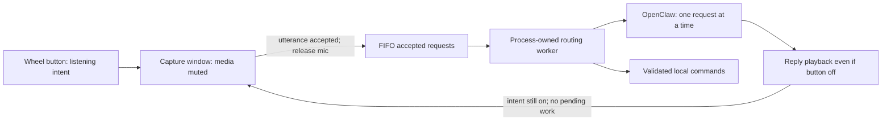

# Voice capture and independent requests

Status: design approved by the user on 2026-11-18 after independent review. Four review findings incorporated below. Implementation plan pending approval.

Human view: [design overview](/private/var/folders/x9/gtfrvfxj7xj6hmdfj89rdhv40000gn/T/agent-plan-voice-p8nw2jbj/design.html). Temporary review progress: [plan.html](/private/var/folders/x9/gtfrvfxj7xj6hmdfj89rdhv40000gn/T/agent-plan-voice-p8nw2jbj/plan.html).

## Problem

The driver reports that podcasts interfere with voice commands and that “Myślę” does not make microphone activity clear. `VoiceController.onPttPressed()` currently stops the continuous session; `stopContinuousSession()` cancels its routing and assistant jobs. `OpenClawClient.startTurn()` rejects a second simultaneous turn with Busy. Therefore toggling the microphone currently cancels a submitted request instead of only controlling listening.

## Constraints

- Keep all submitted requests and speak their final replies even when listening is off. New requests must neither abort nor replace earlier ones.
- Keep the existing OpenClaw protocol, turn identity, uncertainty recovery, action validation, confirmation and ledger checks. Never resend a request just because the microphone restarts.
- Do not capture audio while waiting or speaking. Actually close/release microphone capture and recognition for these phases, rather than merely dropping decoded words.
- Retain media-volume recovery after errors/process death and respect explicit volume changes. Voice output uses a separate BYD voice/navigation stream; verify its existing configuration, without muting it with media.
- Keep Polish negation, quotation and partial-command refusals before command dispatch. Do not rewrite arbitrary text, contacts, destinations or remote questions.
- No deployed OpenClaw changes, car installation or physical-car success claim is part of this implementation.

## Decision

Separate microphone intent from request processing. A button press toggles whether listening is enabled; it no longer cancels accepted work or stops reply playback. A process-owned FIFO worker routes accepted utterances one at a time, preserving the current single-turn OpenClaw contract and shared routing state. Each item captures its text, profile, recognition timing and trace identity before capture closes. A capture generation rejects late callbacks from an older microphone window. The worker and reply playback survive microphone closure and reopening; transport failures and existing deadlines still terminate their own request normally. Each FIFO item owns its complete spoken reply: the worker waits for physical playback completion, or a bounded playback failure, before starting the next item. A successful `speak()` enqueue is not playback completion. This also orders local acknowledgements behind earlier replies and prevents the TTS generation counter from cutting a previous reply short.

Audio follows the user-approved flow: media volume is zero while capture is open, returns to its saved level while a request waits, drops for reply speech, and returns afterwards. Capture resumes after replies finish only if listening remains enabled. Explicitly switching off and on permits a new capture window while an older request waits; its utterance joins the queue. Once that window submits, capture closes again until outstanding work and speech finish. If a reply arrives during this explicit capture window, defer its speech until that window closes, so the reply cannot enter recognition or interrupt the driver's words. Never open capture while speech is active.

Use separate owned media-suppression leases for capture and speech, with restoration only after the final relevant owner releases. This replaces reliance on nested saved-volume calls, which can restore volume while another owner remains active. Capture requests full mute (index 0); speech retains the existing near-silent reply level. Save the actual pre-suppression level once, preserve crash recovery and explicit volume-command semantics, and restore on warm-up failure, capture failure, user-off, terminal request failure and playback failure. While suppression is active, explicit volume commands update the saved restore target but do not raise the effective media volume above the strongest active suppression level. A capture owner (level 0) takes precedence over a reply owner (the existing near-silent level). Only LISTENING means capture is active; retain waiting/speaking status for pending replies when the mic is off. Older replies must not overwrite a newer active capture's status.

`VoiceController.sessionActive()` remains true for capture, queued/running work, deferred replies and physical reply playback, even when listening intent is off. This preserves the exclusion used by `VoiceAutomationActions` for `speak` and `agent_query`, so an automation cannot replace an accepted request or its answer.

Each explicit listening toggle advances an intent generation. An accepted request carries the generation that captured it. Silence timers and request-driven auto-close can change listening intent only if their generation still matches; an older request cannot close a capture window explicitly opened by a later off/on sequence. Ordinary completion resumes capture according to the current intent, not a stale request snapshot.

Add whole-word `łącz` and `lacz` to the command dictionary's `on` rule as aliases of `włącz`. Extend rejected-command detection as needed so malformed or negated forms remain local refusals. Do not globally replace this word in free text. Add exact built-in phrases (including unaccented spellings) using the existing multi-command dictionary expansion:

| Phrase | Dispatch |
| --- | --- |
| dawaj ciepełko | driver seat heat level 1, steering-wheel heat on |
| dawaj ciepełko oba fotele | driver and front passenger seat heat level 1, steering-wheel heat on |

The user confirmed level 1 out of 2, not a calculated half of the car's maximum. Keep the existing per-command execution and stop-on-failure behavior; do not claim a physical state from a successful dispatch.

## Options considered

- **One process-owned FIFO worker (recommended):** accepts new utterances while preserving an earlier request, without changing OpenClaw transport. Requests and replies remain ordered; a later local command may wait behind an earlier remote request. The user approved queuing new requests.
- **Parallel OpenClaw turns:** needs changes to the client's single-turn gate, shared session history, action-result reporting and reply ordering. This adds protocol and safety complexity without a requested benefit.

## Shape

| Phase | Microphone | Podcasts | Button action |
| --- | --- | --- | --- |
| Listening | Open | Muted | Off: close capture and restore media |
| Waiting | Released | Saved volume | Off: disable auto-listen; on again: open a new capture window |
| Reply | Released | Quiet during speech | Toggle future listening; reply continues |
| Off, with pending work | Released | Saved volume except during reply | On: listen when speech is idle |

## Implementation areas and verification contracts

- `voice/VoiceController.kt`: separate capture, request and playback ownership; preserve request journal context, close-after-command behavior and silence timeout for listening only. Update `VoiceStatusTracker.kt` only as needed to represent pending work independently from capture. Existing widget callbacks must not imply that waiting means an open mic.
- `voice/AudioCapture.kt`: ownership-aware media mute/restore, independent capture and reply owners; audit `SherpaTtsEngine.kt` call sites before changing the shared helper contract.
- `voice/PolishVoiceNormalizer.kt`, `resources/voice/pl_commands.txt`, and `voice/NluParser.kt` only if needed: narrow aliases, exact heating phrases, unchanged refusal ordering.
- Write failing tests first in the existing controller, media and Polish parser suites. Required cases: no mic capture while waiting or speaking; off/on with A pending accepts B without cancelling A; FIFO send and reply order; reply after off; reply during capture deferred; no duplicate send from late callbacks; off during warm-up; failed capture/reply/request restores media; overlapping owners and explicit volume changes that remain muted until release; automation exclusion while the button is off with pending work or playback; two fast replies and local acknowledgement behind a remote answer play fully exactly once; stale auto-close cannot close a newer capture or lose its accepted request; automatic resume only when intent permits it; negated/quoted/partial alias and heating phrases never execute.
- Focused checks use `./gradlew :app:testDebugUnitTest --tests '*PolishVoiceControllerTest' --tests '*AudioCaptureDuckTest' --tests '*NaturalPolishCommandsTest' --tests '*PolishCommandSafetyTest' --tests '*PolishCommandGoldenTest'`. Add new suite filters when new suites are created. Broader verification: `./gradlew :app:testDebugUnitTest :app:assembleDebug :app:lintDebug :app:detekt`. Report actual output and any baseline failure separately. No tests have been run for this proposal.

## Risks and scope limits

- Microphone warm-up on older head units can delay each reopened capture window. Keep the ready tone tied to actual readiness, and test preparation cancellation.
- Media and BYD voice-stream behavior needs a physical-car check; unit tests cannot establish that podcasts are inaudible or the car microphone has been released by the driver.
- The current controller shares routing fields and a stop flag with capture. All continuation gates, status handles, auto-close jobs and TTS stop calls must be audited so microphone toggles cannot suppress accepted replies or alter another turn's journal.
- Accepted requests are in-memory. Process death does not promise queued delivery. Preserve the existing no-automatic-resend policy for uncertain remote work.
- No new cancellation gesture is introduced. Connection removal, AI opt-out, transport deadlines and security gates keep their existing authority; microphone off is not a permission bypass.

## Independent design review

All four findings were verified against the named code and accepted into this design; none were deferred.

| Finding | Resolution |
| --- | --- |
| TTS enqueue returns before playback finishes; a later turn can replace speech | FIFO ownership includes bounded physical playback completion |
| Automations depend on sessionActive to avoid taking over shared TTS/agent | Active means capture or any accepted work, deferred reply or playback |
| Old auto-close callbacks can close a new capture window | Capture requests and auto-close carry listening-intent generations |
| Explicit volume writes could break capture mute | Store the requested restore target while strongest suppression remains effective |

Review was a targeted code review. No tests or physical-device checks were run.
